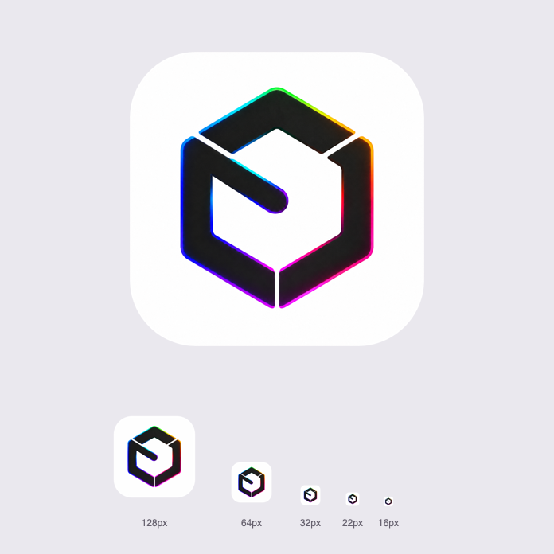

# App icon



The mark is a black hexagonal gauge with a single inward arm. Three clean
cuts separate its top, left, and right sections. Thin rainbow highlights
follow the edges of the matte black surfaces. The white background remains
visible through the center and the cuts.

The shape exploration uses [Rosamax](https://logobook.com/logo/rosamax/) as
its reference. The cuts, rainbow edges, and fine grain follow the approved
[Devie UI logo](references/devie-ui-rainbow.png).

[master.png](master.png) is the unchanged 1254 × 1254 artwork produced by
the built-in image generator. The [prompt record](prompt.md) describes the
inputs and contains the final edit prompt. The exporter never calls an
image service or redraws the mark.

## Assets

The [square](exports/square/) and [rounded](exports/rounded/) sets each
contain PNG files at 16, 22, 32, 64, 128, 256, 512, and 1024px.

- Square exports retain the full white canvas.
- Rounded exports place the artwork on an 824px white plate within a
  1024px canvas, with proportional spacing at smaller sizes. Pixels outside
  the plate are transparent. The center and cuts remain white.
- [app-icon.png](app-icon.png) is the 1024px rounded export used for the
  macOS icon set and the repository README.
- `src/app/icon.png` is the 128px square export. It uses the full canvas
  for better favicon legibility.

The rounded set has transparent outer corners; it is not a transparent
cutout of the mark.

## Regenerating

On macOS, with Bun dependencies installed:

```sh
python3 docs/logo/generate.py
```

The script wraps the master in SVG for resizing and rounded clipping with
the local Tauri CLI. It writes both PNG sets, the favicon, and these native
assets in `src-desktop/icons/`:

- `32x32.png`
- `128x128.png`
- `128x128@2x.png`
- `icon.icns`
- `icon.png`

Quick Look renders the size preview. No additional Python packages are
required. The native bundle configuration already uses these filenames.

The no-quota menu-bar state uses the app's default icon. When a provider is
selected, the menu bar uses that provider's icon and percentage. Provider
logos and quota-status colors remain independent of this app artwork.
